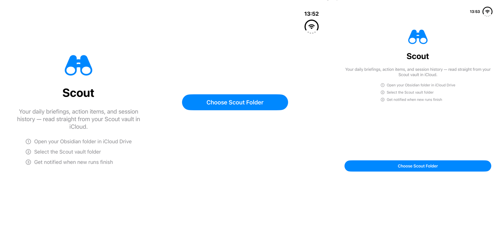
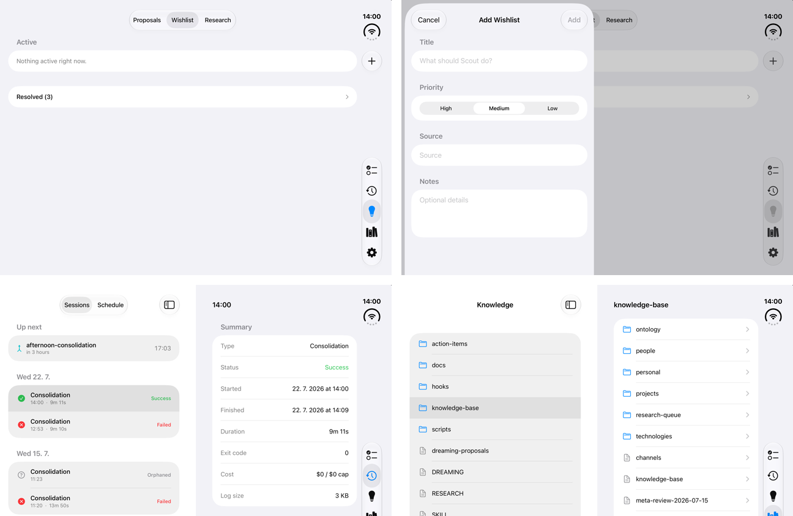
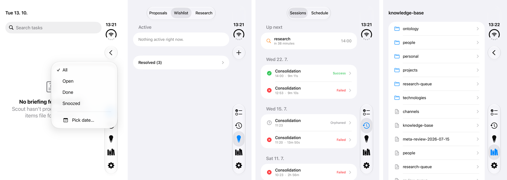
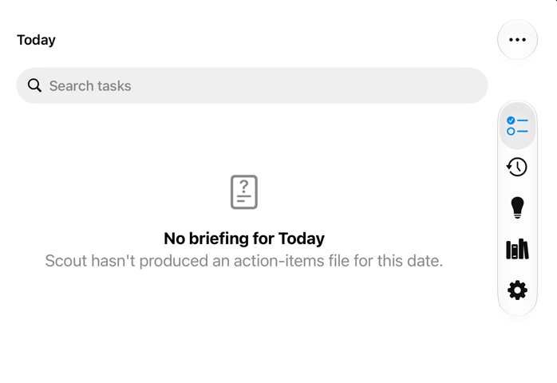

# iPhone Duo support

- **Date:** 2026-10-27
- **Sources:** HIG [Designing for iPhone Duo](https://developer.apple.com/design/human-interface-guidelines/designing-for-iphone-duo)
  (page added 2026-09-09); [Preparing your app for iPhone Duo](https://developer.apple.com/documentation/technologyoverviews/preparing-your-app-for-iphone-duo);
  the Duo tech talks *Design for iPhone Duo*, *Prepare your app for iPhone Duo*, *Raise the bar with iPhone Duo*,
  *Strike a pose with adaptive layouts on iPhone Duo* and *Leverage multiple displays and scenes on iPhone Duo*;
  the `ReservedRegion`, `ArrangementView` and toolbar API reference; Xcode 27 / 27.1 release notes.

## What Apple asks for

iPhone Duo has a compact outer display (wider and shorter than other iPhones) and a large inner display that
can be used flat or partially folded (book pose, laptop pose, standing on its edges). The guidance boils down to:

1. **Build to resize — don't design per pose.** Compact width on the outer display, regular width (and
   regular height) on the inner one; layout margins and safe areas, no fixed widths, no `UIScreen.main`, no
   `userInterfaceIdiom` / interface-orientation layout decisions. The inner display ignores
   `UISupportedInterfaceOrientations`.
2. **Rebuild against the iOS 27.1 SDK.** An iOS 26 build runs in a compatibility area beside the status bar and
   camera; the 27.0 SDK extends it on the inner display; only 27.1 gives the full screen and moves bars to the side.
3. **Use the system bars.** `TabView`, `NavigationStack` and `NavigationSplitView` + `.toolbar` move the
   navigation bar, toolbar and tab bar into a vertical bar on the side (everywhere except the inner display in
   portrait). Items with a title *and* a symbol go vertical; text-only items and custom views (e.g. a segmented
   control) stay in a horizontal bar. Back/Close go on top, then prominent actions; overflow runs bottom to top,
   tunable with visibility priorities.
4. **Same app on both displays, one more level of hierarchy on the inner one** — e.g. Mail shows the list *or*
   the message when closed and both side by side when open. Split views do this for free.
5. **Respect the fold.** Sheets, alerts, menus, toolbar buttons and split views move off the fold on their own,
   and scrolling content (lists, documents, feeds) doesn't need to avoid it. Custom non-scrolling layouts with
   controls should read `ReservedRegion`s (or use an `ArrangementView`) so nothing interactive lands in the crease.
6. **Multitasking just works** — every app takes part in the inner display's side-by-side mode; nothing to opt
   into.

## Audit of Scout-iOS

The app is already plain SwiftUI with system containers, `List`s and `Form`s, no fixed widths and no
screen/idiom/orientation checks, so most of the Duo behavior comes from the 27.1 SDK alone. Per screen:

| Screen | On Duo | Change |
| --- | --- | --- |
| Tab bar (5 tabs, Ideas badge) | Moves to the side bar; badge kept. | None. |
| Today | `List` + search; ‹ › and Filter are `Label`s (title + symbol), so they go vertical. Filter uses its own symbol, not the ellipsis Apple reserves for overflow. One level of hierarchy, nothing to split. | None. |
| Activity | Was a stack: runs → run detail, i.e. a stretched list on the inner display. | **`NavigationSplitView`**: Sessions / Schedule in the sidebar, the selected run in the detail column. Collapses to the same push navigation in compact width. Selection is by `Run.ID` so the 60 s reload doesn't drop it. |
| Ideas | Lists with Approve / Decline / Done cards; ＋ is a `Label`, so it goes vertical. No detail level. | None. |
| Knowledge | Was a stack: folders → note. | **`NavigationSplitView`**: vault root in the sidebar, the picked folder or note in the detail column; deeper folders, notes and wikilinks push onto the detail column's own stack. |
| Settings | `Form`; the keyboard accessory bar stays on the keyboard, as Apple specifies. | None. |
| Sheets (snooze, comment, add item, date, full log) | Text-only Cancel / Done stay horizontal; the system centers sheets and moves them off the fold. | None. |
| Onboarding | Single centered column — the *Choose Scout Folder* button would sit across the fold. | **Fold-aware** via `ReservedRegion`: book pose puts the intro on the leading half and the button on the trailing half; laptop pose puts the button on the stable bottom half. |

The segmented pickers on Activity and Ideas stay in a horizontal bar; Apple calls out segmented controls as
items that should "stay put in the nav bar", and a split view's sidebar column keeps horizontal bars anyway.

## Considered and left out

- **`visibilityPriority`, `axisBehavior`, `toolbarVerticalCompressionBehavior`.** Gating them needs
  `if #available` inside `.toolbar { }`, i.e. `ToolbarContentBuilder.buildLimitedAvailability`, which requires
  iOS 17.5 while the deployment target is 17.0. The defaults suit Scout (the toolbar compresses before the tab
  bar; items overflow bottom to top). Revisit when the target moves to 17.5+.
- **Tab bar as a sidebar on the inner display** (`.sidebarAdaptable`). Apple pitches it for information-dense
  apps; with split views inside Activity and Knowledge it would mean three columns on one screen.
- **`ArrangementView`.** No screen has a two-pane custom layout, and a split arrangement shows only its primary
  view on the closed display in landscape, which would hide the onboarding button.
- **Two-column Today.** It would mean replacing the `List` (and its swipe actions) with a custom grid.
- **Hinge API, scene accessories, multiple windows, camera APIs** — nothing in Scout maps to them.

## Toolchain

| Built with | On iPhone Duo |
| --- | --- |
| Xcode 26.x (Swift 6.3, iOS 26 SDK) | Compiles (Duo code is behind `#if compiler(>=6.4)`); compatibility layout, horizontal bars, no fold handling. Split views still apply. |
| Xcode 27.0 (Swift 6.4, iOS 27.0 SDK) | **Doesn't compile** — passes the compiler guard but lacks the iOS 27.1 symbols. |
| Xcode 27.1+ (Swift 6.4, iOS 27.1 SDK) | Full screen, side bars, fold-aware onboarding. |

## Verification checklist

Walked on 2026-10-27 in the simulator; results per item are under *Verification results* below. On Xcode 27.1
with the iPhone Duo simulator (Device Hub's open / close / rotate / fold controls), plus a regular iPhone simulator
for regressions:

1. `xcodegen generate`, build, and run `ScoutMobileTests`; also build once with Xcode 26.5 to confirm the
   compiler guard.
2. **Outer display, portrait and landscape:** tab bar and toolbar items sit in the side bar; Today's ‹ › and
   Filter and Ideas' ＋ are in it (if they stay horizontal, drop `.labelStyle(.iconOnly)` from those
   `Label`s, since toolbar labels are icon-only by default anyway); the segmented pickers stay in the top bar;
   in landscape, overflowed items show up in the overflow menu.
3. **Activity:** inner display shows runs and the selected run side by side, the row stays highlighted across a
   reload (wait 60 s), and switching to Schedule keeps the detail. Outer display / iPhone 17 Pro: tap a run →
   pushes detail → Back returns to the list. Frame-step a Sessions ↔ Schedule switch for the segmented-picker
   collapse described in `CLAUDE.md`.
4. **Knowledge:** inner display shows the vault root beside the detail; drill into a folder and a note in the
   detail column, follow a `[[wikilink]]`, then pick another root entry — the detail stack must reset. Outer
   display: the same flow as before, Back all the way out to the root.
5. **Fold (book and laptop pose)** with a fresh install (onboarding): the intro and the button land on
   opposite sides of the fold and nothing straddles it; unfolding returns to the single column. Then check that
   sheets, alerts and the Filter menu slide off the fold on their own.
6. **Inner display, Split View multitasking** with the app on the left and on the right: the side bar follows
   the outer edge and no content hides under it.
7. **Regression on a non-Duo iPhone:** every tab behaves as before; on a Pro Max in landscape (regular width)
   Activity and Knowledge now show two columns, as Mail and Notes do.

## Verification results

Xcode 27.1 (27A9275) with the iPhone Duo simulator on iOS 27.1 (24A94425). The iOS 27.1 runtime only runs iPhone Duo, so
the regular iPhones ran on iOS 27.0 (24A434) with the same Xcode. UI checks were driven by a throwaway XCUITest
against a copy of a real vault, with screenshots taken per display through `simctl io <device> screenshot --display=<id>`.
No code changes were needed, so the design above is unchanged.

| # | Item | Result |
| --- | --- | --- |
| 1 | Build and unit tests | Xcode 27.1 builds clean, no warnings in the changed files. `ScoutMobileTests` 88/88 on iPhone Duo (27.1) and iPhone 17 Pro (27.0). Xcode 26.5 builds and passes 88/88 on iPhone 17 Pro (26.5), so the `#if compiler(>=6.4)` guard holds. |
| 2 | Outer display | Portrait: tab bar, Today's ‹ › and Filter, and Ideas' ＋ sit in the vertical side bar; the segmented pickers stay in the top bar; Back is at the top of the side bar. `.labelStyle(.iconOnly)` didn't keep the `Label`s horizontal, so it stays. Landscape: ‹ › and Filter overflow into the side bar's ••• menu. |
| 3 | Activity | Inner display (and a Pro Max in landscape): runs and the selected run side by side, the row stays selected across the 60 s reload (waited 65 s), Schedule keeps the detail. Outer display and iPhone 17 Pro: tap a run → detail pushes → Back returns to the list. Frame-stepping six Sessions ↔ Schedule switches on iPhone 17 Pro showed no segmented-control collapse. |
| 4 | Knowledge | Inner display: root beside the detail, a folder and a note open in the detail column, `[[channels]]` pushes onto the detail stack, picking another root entry resets it to that entry. Outer display and iPhone 17 Pro: folder → note → Back twice to the root. |
| 5 | Fold | Book pose: onboarding puts the intro on the leading half and *Choose Scout Folder* on the trailing half; the Filter menu opens on the trailing half and the Add sheet on the leading half; split views put list and detail on either side of the fold. Laptop pose: intro on the top half, button on the bottom half. Flat: single column again. |
| 6 | Split View multitasking | Not verified (no scripted way to arrange two apps side by side). |
| 7 | Non-Duo regression | iPhone 17 Pro (27.0 and 26.5): every tab as before, onboarding unchanged. iPhone 17 Pro Max in landscape (regular width): Activity and Knowledge show two columns. |

Screenshots (iPhone Duo simulator, iOS 27.1):

- Onboarding in book pose (left) and laptop pose (right):
  
- Book pose: Ideas, the Add sheet, and the Activity and Knowledge split views:
  
  The Add sheet sits on the leading half on purpose: in book pose the system moves sheets off the fold rather
  than centering them across the crease (HIG: sheets, alerts and menus avoid the fold on their own). With the
  device open flat the same sheet is centered.
- Outer display, portrait: Filter menu, Ideas' ＋ and the tabs in the side bar, Activity, Knowledge:
  
- Outer display, landscape: ‹ › and Filter overflow into the ••• menu:
  

Findings:

- **Inner display in portrait** (horizontal bars, as Apple specifies) opened Activity and Knowledge on the empty detail
  placeholder with the sidebar collapsed behind its toggle. *Fixed:* the split view is too narrow there to tile
  (the sidebar can only overlay the detail, whatever the column widths), so `listDetailColumns(_:selection:)`
  shows the list as an overlay until something is picked, then the detail full width; where the container is wider
  than tall both columns stay visible. Size classes can't tell the two apart (both regular × regular), hence the
  container's shape. Knowledge also needed the setting re-applied after appearing: its detail `NavigationStack`
  makes the split view drop to `.detailOnly` on first appearance.
- On the inner display the first tab tap right after dismissing the Filter menu didn't switch tabs in XCUITest (a second
  tap did). Synthetic taps can't tell whether a real finger hits the same thing; check on a device.
- The Duo simulator has no `simctl` command for poses. Besides Device Hub, poses can be scripted from inside the
  simulator through SpringBoard's private display tool service (`SBSDisplayToolService`
  `swapDisplayWithSettings:completion:`, the service Apple's internal `suiatool` uses). That needs a simulator binary
  carrying the `com.apple.springboard.sbdisplay.service` entitlement in its `__TEXT,__entitlements` section; it is how
  the poses above were set. It is private SPI, for local testing only.
- XCUITest drives both displays, but its own screenshots come out black on the Duo; capture with `simctl io` instead.
  Display IDs change when the simulator reboots, so look them up with `simctl io <device> enumerate`.

Still unverified: a real device (including first-tap behavior), Split View multitasking, standing poses, and the
Xcode 26.5 build *running* on Duo in the compatibility layout.
